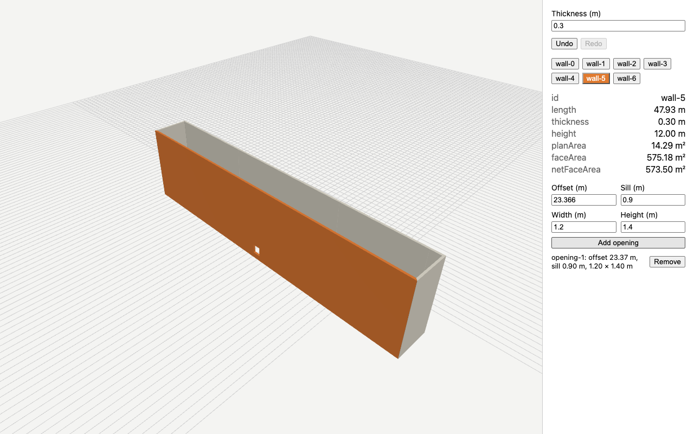

# footprint-to-ifc

[](https://github.com/AhmadSaleh22/footprint-to-ifc/actions/workflows/ci.yml)

Turns a building footprint into a 3D building in the browser, with walls you can select and window openings you can add, undo and redo. IFC export is the next step.

**Live demo:** https://ahmadsaleh22.github.io/footprint-to-ifc/



The fixture is a real building in Berlin-Kreuzberg, from the city's open LoD2 data.

## How it was built

Every step was built with Claude Code in the same loop, and the git history shows it:

1. I write a spec in `specs/` with invariants and concrete acceptance criteria. A read-only review agent (`.claude/agents/spec-reviewer.md`) checks it before any code exists.
2. Claude Code implements it, tests first (`feat(NN)` commits), and mutation-tests its own tests.
3. I review the result and commit my changes separately (`review(NN)`).
4. `VERIFY.md` records what I checked by hand, what I checked against an independent tool (PROJ, Shapely), and where the agent, the reviewer or I were wrong.

Some things this loop caught:

- An invariant I wrote, "sum of wall areas equals the band area", holds for any inner ring, so it proved nothing about overlap. It was replaced with an inside check and a separating-axis test.
- WebGL stores vertex positions as Float32. At a UTM northing of 5,816,000 m, Float32 values are 0.5 m apart, which is why core keeps coordinates relative to a local origin.
- A bug no test caught, `scene.add()` with no argument in the error state, was found in the console. Every e2e test now fails on console errors.
- fast-check's `double` favours its endpoints, so most property cases used the extreme thicknesses until the draws were made uniform.
- Three.js's triangulation (earcut) drops triangles when two windows share a sill or head height, which left cracks in the wall. A property test found it, and a repair step now splits triangles at vertices lying on their edges.

Details are in [VERIFY.md](VERIFY.md).

## Status

- 01 Footprint to local coordinates (GeoJSON to EPSG:25833): done
- 02 Walls with mitred corners: done
- 03 Three.js viewer with picking: done
- 04 Window openings with undo and redo: done
- 05 IFC export: next
- 06 Round-trip verification of the IFC file: planned

## Run it

Requires Node 22.12 or newer and pnpm.

```
pnpm install
pnpm dev
pnpm test
pnpm exec playwright install chromium
pnpm test:e2e
```

## Layout

- `specs/`: one spec per step, with `00-overview.md` for the plan
- `src/core/`: pure TypeScript geometry (no Three.js, React or web-ifc imports, enforced by ESLint)
- `src/viewer/`: Three.js and React
- `e2e/`: Playwright tests
- `scripts/`: fixture extraction, debug drawings and the README screenshot
- `CLAUDE.md`: rules the agent follows
- `VERIFY.md`: the verification record

## Version pins

- **TypeScript is pinned to 6.0.3**, not the latest 7.x. `typescript-eslint` (8.72.0) declares a peer range of `typescript >=4.8.4 <6.1.0`, so 7.x would break linting.
- **React is pinned to 18.3.1** to match the target stack.
- All dependencies are pinned to exact versions (`.npmrc`: `save-exact=true`).

## Data

Fixture data: Berlin LoD2 building models, Senatsverwaltung für Stadtentwicklung, Bauen und Wohnen Berlin, licence dl-zero-de/2.0.
